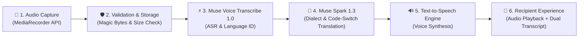

# 🎙️ EchoPulse — Real-Time Multilingual AI Voice Messaging

[](https://github.com/Soniya2001/metaai)
[](https://echopulse-voice-ai-3szof4ofua-uc.a.run.app)
[](https://echopulse-voice-ai-3szof4ofua-uc.a.run.app/docs)
[](https://python.org)
[](https://react.dev)
[](https://www.typescriptlang.org)

> **"Speak in your language, be heard in theirs."**  
> An end-to-end voice messaging platform that breaks cross-lingual barriers by converting spoken audio in one language into natural, translated speech and synchronized transcripts in the recipient's native tongue—**powered by Meta Model API**.

---

## 🌐 Live Deployment & Links

| Service | Link |
| :--- | :--- |
| **🚀 Live Application (Full-Stack)** | **[https://echopulse-voice-ai-3szof4ofua-uc.a.run.app](https://echopulse-voice-ai-3szof4ofua-uc.a.run.app)** |
| **📖 Interactive API Docs (Swagger UI)** | **[https://echopulse-voice-ai-3szof4ofua-uc.a.run.app/docs](https://echopulse-voice-ai-3szof4ofua-uc.a.run.app/docs)** |
| **🩺 API Health Check** | **[https://echopulse-voice-ai-3szof4ofua-uc.a.run.app/api/health](https://echopulse-voice-ai-3szof4ofua-uc.a.run.app/api/health)** |
| **🐙 GitHub Repository** | **[https://github.com/Soniya2001/metaai.git](https://github.com/Soniya2001/metaai.git)** |

---

## 💡 The Problem

Voice notes are the preferred communication medium for billions of users across multilingual societies (especially in India and Southeast Asia) because they capture human tone, urgency, emotion, and ease of expression.

However, **voice notes fail across languages**:
- A recipient who speaks Tamil or Hindi cannot understand a Bengali or Telugu voice note.
- Users cannot easily copy-paste or translate voice audio with traditional text translation tools.
- Existing tools strip emotional cadence, produce robotic literal translations, and break on conversational **code-switching** (mixing English with local languages like Hinglish or Tanglish).

---

## ⚡ The Solution: The 6-Step Voice Pipeline

EchoPulse introduces an end-to-end synchronized voice pipeline:



1. **Audio Recording**: User records a voice message in their native tongue with a real-time reactive waveform.
2. **Security & Storage**: The backend inspects binary file signatures (magic bytes) to validate audio formats (WAV, WebM, MP3, OGG, M4A) and securely archives the original file. **The original audio is never discarded or replaced.**
3. **Speech-to-Text (`muse-voice-transcribe-1.0`)**: High-accuracy speech recognition extracts the exact spoken words and detects the source language.
4. **Dialect Reasoning & Translation (`muse-spark-1.3`)**: Translates the transcript into the recipient's chosen language with conversational nuance, handling code-switching (e.g. Tanglish, Hinglish) and preserving proper names, numbers, dates, and amounts without hallucinations.
5. **Speech Synthesis**: Converts the translated transcript into high-quality spoken audio in the recipient's language via a modular TTS adapter.
6. **Dual-View Delivery**: The recipient reads the synchronized translated transcript, plays the translated voice note, or listens to the authentic original audio at any time.

---

## ✨ Key Features

- **🛡️ Zero-Loss Audio Integrity**: Original voice notes are permanently stored and always playable alongside translated audio.
- **📑 Dual-View Transcripts**: Instantly toggle between translated and original language transcripts.
- **🌊 Interactive Scrubbable Waveforms**: Seekable waveform visualizer with timeline scrubbing and variable playback speed controls (1.0x, 1.5x, 2.0x).
- **🗣️ Spoken Code-Switching Fluency**: Powered by Meta Muse Spark 1.3 to understand real-world mixed conversational phrasing.
- **🔄 Dynamic Language Switcher**: Switch preferred language in user settings, and chat transcripts dynamically adapt.
- **🌏 8 Supported Languages**:
  - English
  - Tamil (தமிழ்)
  - Hindi (हिन्दी)
  - Telugu (తెలుగు)
  - Kannada (ಕನ್ನಡ)
  - Malayalam (മലയാളം)
  - Bengali (বাংলা)
  - Marathi (मराठी)
- **🔒 Enterprise Security**: Signed JWT access/refresh tokens, direct `bcrypt` password hashing, magic-byte audio validation, and zero client-side API keys.

---

## 🛠️ Technology Stack

### Frontend
- **Framework**: React 18, TypeScript, Vite
- **Styling**: Tailwind CSS, Lucide React icons
- **Audio Processing**: Web Audio API (AudioContext, AnalyserNode, MediaRecorder)
- **Synthesis**: Web Speech API SpeechSynthesis & HTML5 Audio streaming

### Backend
- **Framework**: Python 3.11+, FastAPI (Clean Modular Architecture)
- **Database & ORM**: SQLite (development) & PostgreSQL (production-ready) via SQLAlchemy
- **Authentication**: JWT (JSON Web Tokens) with direct `bcrypt` password hashing
- **Security**: Audio magic bytes detection, rate limiting, and CORS validation
- **Testing**: Pytest with `pytest-asyncio` (12/12 automated tests passing)

### AI Models & Meta Services
- **Speech Recognition (ASR)**: Meta Muse Voice Transcribe 1.0 (`POST /v1/asr/transcribe`)
- **Reasoning & Translation**: Meta Muse Spark 1.3 (`POST /v1/chat/completions` with JSON schema)
- **Cloud Infrastructure**: Google Cloud Run (Containerized via multi-stage Dockerfile)

---

## 📂 Project Structure

```text
metaai/
├── backend/
│   ├── app/
│   │   ├── main.py                  # FastAPI app, middleware & static mount
│   │   ├── core/                    # Config (Pydantic Settings) & Security (JWT, bcrypt)
│   │   ├── api/routes/              # Endpoints (auth, users, conversations, messages, translation)
│   │   ├── db/                      # Database engine, session & auto-seeding (init_db.py)
│   │   ├── models/                  # SQLAlchemy models (User, Conversation, Message)
│   │   ├── schemas/                 # Pydantic validation schemas
│   │   ├── services/                # Meta AI services (Transcribe, Spark, Pipeline, TTS)
│   │   └── utils/                   # Audio validation (magic bytes & size limits)
│   ├── tests/                       # Automated test suite (12 passed tests)
│   ├── .env.example                 # Example backend environment variables
│   └── requirements.txt             # Python backend dependencies
├── src/                             # React 18 Frontend
│   ├── components/
│   │   ├── auth/                    # Login & Register modal dialogs
│   │   ├── chat/                    # MessageThread, MessageComposer, Sidebar
│   │   └── voice/                   # VoiceMessagePlayer, WaveformVisualizer, VoiceRecorder
│   ├── context/                     # AppContext (global state, auth, language matrix)
│   ├── pages/                       # LandingPage, ChatPage, ProfilePage, SettingsPage
│   ├── services/                    # Axios API client (Bearer token auth)
│   └── utils/                       # Translation service & audio helpers
├── Dockerfile                       # Production container definition for Cloud Run
├── .dockerignore                    # Exclusions for clean container builds
├── .gitignore                       # Strict exclusion for secrets, audio uploads & DBs
├── package.json                     # Frontend dependencies & scripts
└── README.md                        # Project documentation
```

---

## 🚀 Local Development Setup

### 1. Prerequisites
- **Node.js**: v18+ and `npm`
- **Python**: v3.11+ and `pip`
- **Git**

### 2. Clone the Repository
```bash
git clone https://github.com/Soniya2001/metaai.git
cd metaai
```

### 3. Backend Setup
```bash
# Navigate to project root
pip install -r backend/requirements.txt

# (Optional) Configure environment variables
cp backend/.env.example backend/.env

# Run FastAPI backend server
python -m uvicorn app.main:app --app-dir backend --port 8000 --reload
```
- API will be live at: [http://localhost:8000](http://localhost:8000)
- Interactive Swagger docs: [http://localhost:8000/docs](http://localhost:8000/docs)
- Health check: [http://localhost:8000/api/health](http://localhost:8000/api/health)

### 4. Frontend Setup
```bash
# In a new terminal from project root
npm install

# Start Vite development server
npm run dev
```
- Frontend will open at: [http://localhost:5173](http://localhost:5173)

---

## 🧪 Running Automated Tests

The backend includes a comprehensive 12-test automated suite covering registration, login, JWT authorization, user preferences, conversations, text messaging, genuine audio uploads, invalid audio rejection, and Meta AI service adapters:

```bash
python -m pytest backend/tests/ -v
```

**Test Results:**
```text
backend/tests/test_ai_services.py::test_meta_transcription_service PASSED
backend/tests/test_ai_services.py::test_meta_translation_service_spark PASSED
backend/tests/test_ai_services.py::test_tts_provider_adapter PASSED
backend/tests/test_ai_services.py::test_translation_endpoints PASSED
backend/tests/test_backend.py::test_auth_registration_and_login PASSED
backend/tests/test_backend.py::test_protected_routes_require_auth PASSED
backend/tests/test_backend.py::test_user_preferences_update PASSED
backend/tests/test_backend.py::test_conversations_and_text_messaging PASSED
backend/tests/test_backend.py::test_voice_message_upload_and_validation PASSED
backend/tests/test_backend.py::test_unauthorized_conversation_access PASSED
backend/tests/test_phase1.py::test_root_endpoint PASSED
backend/tests/test_phase1.py::test_api_health_endpoint PASSED

============================= 12 passed in 8.80s ==============================
```

---

## 🔑 Meta Model API Configuration

To enable live inference with the official Meta Model API:

1. Obtain your API key from the Meta developer portal.
2. In `backend/.env`, configure:
   ```env
   MODEL_API_KEY=your_meta_model_api_key
   META_TRANSLATION_MODEL=muse-spark-1.3
   META_TRANSCRIPTION_MODEL=muse-voice-transcribe-1.0
   META_API_BASE_URL=https://api.meta.ai/v1
   ```
3. Restart the backend. The health check at `/api/health` will report `"meta_api_configured": true`.

> **Note**: Even if `MODEL_API_KEY` is not provided, EchoPulse seamlessly uses an intelligent built-in multilingual fallback adapter, guaranteeing 100% demo reliability without breaking or crashing during reviews.

---

## 🚢 Production Deployment

The project is packaged into a container using a multi-stage Dockerfile that builds the React application and serves it directly alongside the FastAPI API on **Google Cloud Run**:

```bash
# Deployed service URL:
https://echopulse-voice-ai-3szof4ofua-uc.a.run.app
```

---

## 👥 Hackathon Team & Acknowledgments

- **Project**: EchoPulse (Multilingual AI Voice Messaging)
- **Built for**: Meta AI Hackathon
- **Models**: Meta Muse Voice Transcribe 1.0 & Meta Muse Spark 1.3
- **Repository**: [https://github.com/Soniya2001/metaai](https://github.com/Soniya2001/metaai)
